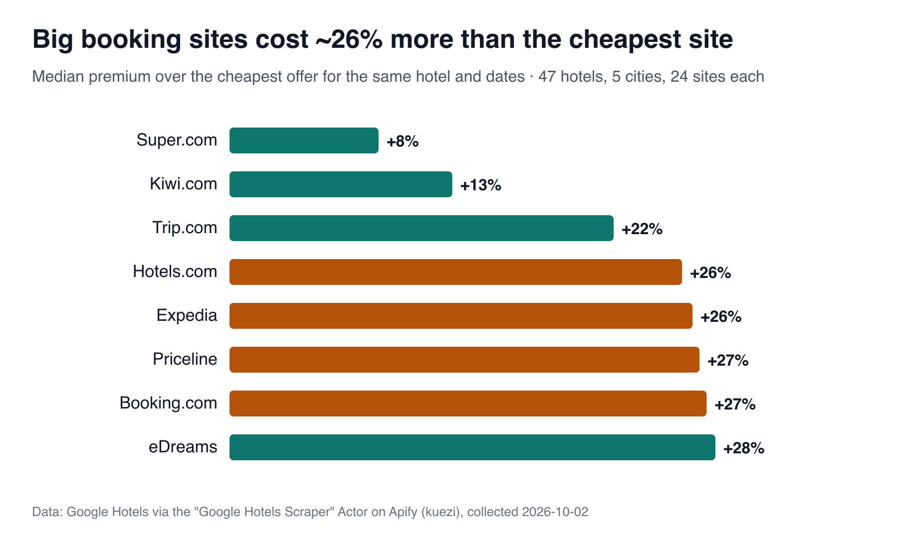
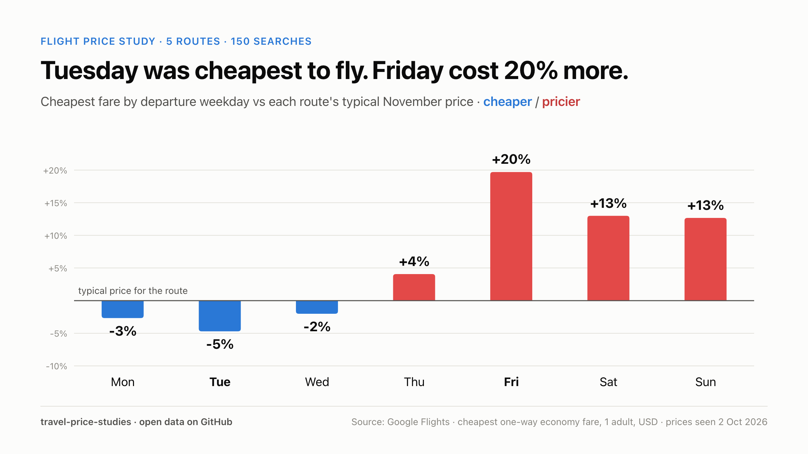
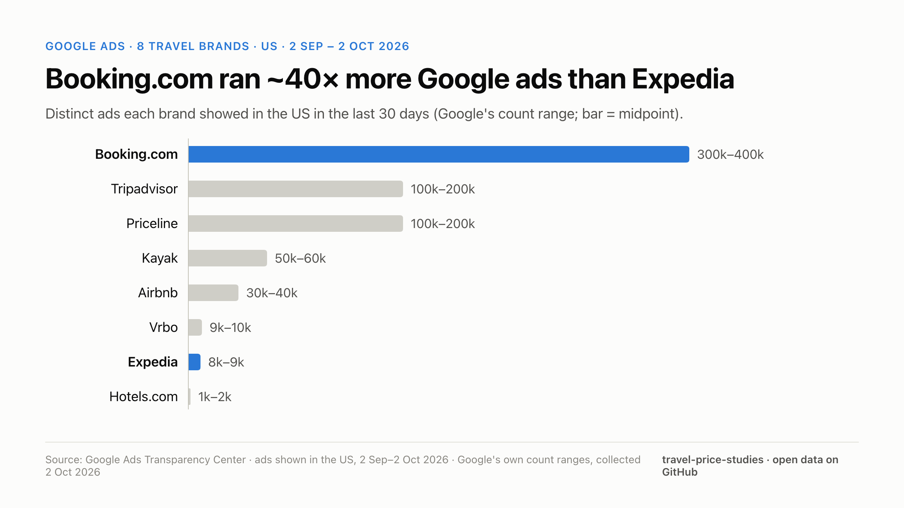

# Travel price studies (open data)

Small, reproducible studies of what travellers actually pay, collected from Google Hotels and Google Flights.
Everything here can be re-run with `python3 analysis.py`. **Data: CC BY 4.0. Code: MIT.**

## 1. Which booking site is cheapest? (collected 2 Oct 2026)

- **What:** 47 hotels (the top 10 Google Hotels results in Paris, London, New York, Barcelona and Bangkok), compared on 24.4 booking sites per hotel on average.
- **Stay:** 12–15 Nov 2026, 3 nights, 2 adults, USD, US point of sale.
- **Result: big brands cost a median 26–27% more than the cheapest site for the same hotel and dates.** Booking.com +27.2%, Priceline +26.8%, Expedia +26.4%, Hotels.com +25.8%.
- The cheapest offer most often came from smaller sites: Super.com, Vio.com and Traveluro (9 hotels each).
- **Expedia, Hotels.com, Orbitz, Travelocity and CheapTickets showed the identical price on 37 of 45 hotels.**
- The hotel's own website was cheapest on only 4 of the 34 hotels where it could be identified by name.
- The median spread between the cheapest and the priciest site for the same room was 67%: New York 41%, Paris 62%, Barcelona 67%, London 98%, Bangkok 116%.
- Google's headline price matched the cheapest site on 42 of 47 hotels.

**Caveats:**
- These are listed prices; nothing was booked.
- Smaller sites can have stricter cancellation terms, member-only rates or fees added at checkout.
- One stay window, one collection day.

**Robustness checks (3 Oct 2026, after a reader's questions):**
- *Is the premium just a "minimum of many quotes" effect?* No. The Booking.com premium doesn't rise with the number of listed sites: correlation 0.01 (Expedia −0.08, Hotels.com −0.08). Hotels with 26 or fewer sites show +39.7%, hotels with more show +28.3%.
- *Against the median site instead of the cheapest:* Booking.com +3.9% mean / 0.0% median, Expedia +1.6% / 0.0%, Hotels.com +0.8% / 0.0%. **The big brands price at the typical level. The gap comes from one or two small sites undercutting everyone,** so check the cheapest site, but don't read this as "big brands overcharge".
- Cancellation terms weren't captured, so part of the cheapest-site gap may be non-refundable or member-only rates. The next run records them.

**Pre-registered test (written 7 Oct 2026, before the 9 Oct pull):**
A reader asked whether the three small sites that were cheapest on 2 Oct keep their edge on fresh data. So that nobody can pick the sites after seeing the new pull, the picks and the method are fixed here now, in [`preregistered_test.py`](preregistered_test.py):
- Fixed picks: **Super.com, Traveluro, Vio.com**. They were chosen from the 2 Oct data, so the 2 Oct numbers are in-sample.
- Baseline per hotel: the cheapest big-brand price (Booking.com, Expedia, Hotels.com, Orbitz, Travelocity, CheapTickets, Priceline, Agoda, Trip.com). Eligible hotels have at least one big-brand price and three or more smaller sites. A hotel where a pick isn't listed counts as 0 saving.
- In-sample, 2 Oct (45 hotels, full gap 16.2%): Super.com 5.8% (36% of the gap); + Traveluro 10.1% (62%); + Vio.com 12.3% (76%).
- Pass criterion: the three picks capture **more than 50% of the full gap** on the 9 Oct pull, and again on 16 Oct.
- Persistence: the share of hotels whose cheapest site is the same on 2 and 9 Oct, against a chance baseline from shuffling site labels within each hotel (10,000 shuffles, ties count as a match).
- **Added 8 Oct, still before the 9 Oct pull** (reader follow-up):
  - The full gap is the mean of per-hotel percentages. `python3 preregistered_test.py <csv> --dump` writes the per-hotel baseline, best small-site price and best pick price ([2 Oct dump](data/hotels-booking-site-prices-2026-10-02-per-hotel.csv)).
  - The capture share gets a 95% bootstrap interval over hotels (10,000 draws, seed 7). In-sample 2 Oct: 76%, interval 65–87%.
  - Verdict per date: **PASS** only if the interval's lower bound is above 50%; **INCONCLUSIVE** if only the point estimate is; **FAIL** if the point estimate is 50% or below.
  - Across both dates: the picks "keep most of the gap" only if 9 Oct and 16 Oct both PASS. One PASS and one FAIL means the shortlist isn't stable and the advice stays "compare every site". Any other mix is inconclusive.
  - Persistence is also reported for hotels where all three picks are listed on both dates (9 hotels qualify on 2 Oct alone, so that subset will be small).
- The results will be added here after each pull, whatever they show.

**Results:**
- **9 Oct (out of sample): PASS.** 45 eligible hotels, full gap 13.5%. The three picks saved 10.1%, which is 75% of the gap (95% CI 56–90%). Super.com alone: 47%.
- **17 Oct (out of sample): INCONCLUSIVE.** This pull is one day late: the scheduled 16 Oct job failed, so the same inputs were run on 17 Oct. 48 eligible hotels, full gap 15.8%. The three picks saved 10.3%, 65% of the gap (95% CI 48–82%). The point estimate is above 50%, but the lower bound isn't.
- **Verdict under the two-date rule: inconclusive.** One PASS and one INCONCLUSIVE doesn't count as "keeps most of the gap", so the advice stays: compare every site. Google's headline price, which matched the cheapest site on 42 of 47 hotels on 2 Oct, does that comparison for you.
- **Persistence (same cheapest site on both dates):**

  | Dates | Hotels | Same cheapest site | Chance |
  |---|---|---|---|
  | 2 → 9 Oct | 30 | 63% | 5% |
  | 9 → 17 Oct | 25 | 56% | 13% |
  | 2 → 17 Oct | 25 | 40% | 5% |

  The undercutter repeats far more often than chance, and less often as the gap between pulls grows.
- **Like-for-like** (a reader's question, 16 Oct): [`like_for_like.py`](like_for_like.py) recomputes everything on only the hotels eligible on every date.
  - On the 30 hotels shared by 2 and 9 Oct, the full gap fell from 17.8% to 13.4%. On the 20 hotels present on all three dates, it went 18.7%, 13.7%, 13.5%. So the drop after 2 Oct is a price change, not only Google's top 10 rotating.
  - On those 20 hotels, the three picks captured 75%, 88% and 77% of the gap.
  - On the 25 hotels shared by 9 and 17 Oct, the picks captured 70% and 82%. The lower 65% on the full 17 Oct set comes from hotels that weren't in the 9 Oct set.

Data: [`data/hotels-booking-site-prices-2026-10-02.csv`](data/hotels-booking-site-prices-2026-10-02.csv), one row per hotel × site.

## 2. What's the cheapest day to fly? (prices seen 2 Oct 2026)

- **What:** the cheapest one-way economy fare for every departure day in November 2026 (1 adult, USD, US point of sale) on 5 routes: JFK→LAX, LHR→JFK, ORD→MIA, SFO→HNL and LAX→NRT. That's 150 searches.
- **Result: Tuesday −4.7%, Monday −2.7%, Wednesday −2.0%, Thursday +4.1%, Friday +19.7%, Saturday +13.0%, Sunday +12.7%** vs each route's November median.
- Wrong day vs right day: SFO→HNL $163 vs $444 (+172%); JFK→LAX $184 vs $489 (+166%).
- The Sunday after Thanksgiving (29 Nov) was the priciest day of the month on JFK→LAX and ORD→MIA.
- Google labelled LHR→JFK prices "low" on 21 of 30 days.
- **Robustness check (suggested by a reader):** dropping the Thanksgiving window and using **1–19 Nov only** gives Mon −5.2%, Tue −2.8%, Wed +2.1%, Thu +10.2%, **Fri +13.9%**, Sat +7.6%, Sun +5.2%.
  - The holiday inflates the headline: Friday falls from +19.7% and Sunday from +12.7%.
  - Monday edges out Tuesday as the cheapest day.
  - Friday is still the priciest, but on only 2 Fridays × 5 routes.

**Caveats:** 5 routes, one month that includes US Thanksgiving, prices seen on one day.

**Lead-time check (the same 150 searches pulled on 2, 9 and 17 Oct):**
A reader pointed out that with one collection day, 1 Nov is both "a Sunday" and "closest to departure". Three pulls let weekdays be compared at the same lead time. Script: [`lead_time.py`](lead_time.py).
- **Same flights, later pull:**
  - 2 → 9 Oct: median change 0.0% (45 up, 57 down, 48 unchanged).
  - 9 → 17 Oct: median +5.2%, mean +12.3% (84 up, 41 down, 25 unchanged).
  - Prices held for a week, then rose. 2 → 17 Oct by route: LHR→JFK +15.1%, LAX→NRT +5.8%, SFO→HNL +5.6%, JFK→LAX 0.0%, ORD→MIA −2.8%.
- **Weekday at equal lead time:**
  - Method: log(fare) ~ route + weekday + 7-day lead-time bucket, on 450 fares. Effects are against the average weekday. 90% intervals come from resampling departure dates.

  | Day | All of November | 1–19 November |
  |---|---|---|
  | Mon | −7.8% (−12.9 to −2.9) | −7.2% (−13.1 to −1.6) |
  | Tue | −10.1% (−13.4 to −7.1) | −7.5% (−10.7 to −4.4) |
  | Wed | −5.0% (−8.8 to −1.1) | −1.4% (−5.2 to +4.4) |
  | Thu | +0.2% (−4.5 to +5.8) | +4.3% (−1.9 to +13.7) |
  | Fri | **+12.0%** (+4.4 to +22.5) | **+8.1%** (+5.5 to +10.6) |
  | Sat | +5.4% (−4.9 to +18.3) | −2.2% (−4.6 to +0.2) |
  | Sun | +7.4% (+2.7 to +12.0) | +7.1% (+4.1 to +10.2) |

- **Friday is still the priciest day at equal lead time**, about 8–12% above the average weekday. The headline +19.7% used a different baseline (the route median) and mixed in lead time and Thanksgiving.
- **Monday vs Tuesday:** +2.5% (−4.0 to +9.2) for all of November and +0.4% (−7.1 to +7.9) for 1–19 Nov. That's no detectable difference. Early in the week is cheaper than late in the week, but this data can't say which early day is cheapest.

Data: [`data/flights-cheapest-fare-by-day-2026-10-02.csv`](data/flights-cheapest-fare-by-day-2026-10-02.csv), one row per route × day, with Google's price level and typical range.

## 3. How do the big travel brands advertise on Google? (collected 2 Oct 2026)

- **What:** Google Ads Transparency Center counts for 8 travel websites. Ads shown in the US from 2 Sep to 2 Oct 2026, broken down by platform and format, plus the first 400 ads Google lists for each brand.
- **Result: Booking.com showed ~300k–400k distinct ads, about 40× Expedia (8k–9k).** Tripadvisor and Priceline were at 100k–200k each, Kayak 50k–60k, Airbnb 30k–40k, Vrbo 9k–10k and Hotels.com 1k–2k.
- **Formats:** Booking.com is almost entirely text (Search) ads: **29 video ads**, against Expedia's **2k–3k**. Priceline showed no video ads.
- **Google Maps:** Booking.com 20k–30k ads, Priceline 8k–9k, Tripadvisor 4k–5k, Kayak 0.
- **Shopping and Play:** 25 Shopping ads or fewer per brand, and 0 Google Play ads.
- **New creative:** among the first 400 ads Google lists for each brand, the number first shown in the last 30 days was Vrbo 84, Hotels.com 71, Expedia 58, Priceline 21, Airbnb 4, Booking.com 1, Tripadvisor 1 and Kayak 0.
- **Files:**
  - `data/google-ads-travel-brands-us-2026-10-02.csv`: Google's count ranges per brand × platform/format.
  - `data/google-ads-travel-brands-us-sample-2026-10-02.csv`: 3,200 ad records with advertiser, ad ID, format, first and last shown, and a link.

**Caveats:**
- Counts are Google's own **ranges** of distinct ad creatives, not impressions or spend.
- "YouTube" as a platform includes text ads shown in YouTube search.
- The 400-ad samples follow Google's listing order, so they are not random.

## Run these studies yourself
One-click setups on Apify (change the city, route or brand to your own):
- [Compare a hotel's price on Booking, Expedia & 20+ other sites](https://apify.com/kuezi/google-hotels-scraper/examples/compare-hotel-prices-across-booking-sites)
- [Find the cheapest day to fly on any route](https://apify.com/kuezi/google-flights-scraper/examples/find-cheapest-day-to-fly)
- [Get Google's price insights for a route (low, typical, high)](https://apify.com/kuezi/google-flights-scraper/examples/google-flights-price-insights)
- [See every Google ad a competitor runs in the US](https://apify.com/kuezi/google-ads-transparency-scraper/examples/competitor-google-ads-us)
- [Download a brand's YouTube video ads with links](https://apify.com/kuezi/google-ads-transparency-scraper/examples/youtube-video-ads-of-a-brand)

## How the data was collected
*Disclosure: I built both tools.*
- Hotels: [Google Hotels Scraper on Apify](https://apify.com/kuezi/google-hotels-scraper), with `includeVendorPrices: true`.
- Flights: [Google Flights Scraper on Apify](https://apify.com/kuezi/google-flights-scraper), with a `scanDepartureUntil` date range.
- Ads: [Google Ads Transparency Scraper on Apify](https://apify.com/kuezi/google-ads-transparency-scraper), with `country: US`, `lastDays: 30` and per-platform/format filters.
- Trend data for future studies: [Google Trends Scraper on Apify](https://apify.com/kuezi/google-trends-scraper).

Every pull uses the same inputs ([`scripts/flights-input.json`](scripts/flights-input.json), [`scripts/hotels-input.json`](scripts/hotels-input.json)), and the CSVs are built with [`scripts/build_flights.py`](scripts/build_flights.py) and [`scripts/build_hotels.py`](scripts/build_hotels.py). Pulls: 2, 9 and 17 Oct 2026.

Booking links were removed from the public data because they contain ad-tracking parameters.

## Cite
> Travel price studies (2026). Booking-site premiums and cheapest departure days, collected from Google Hotels and Google Flights. https://github.com/ISHEMAH/travel-price-studies (CC BY 4.0)
